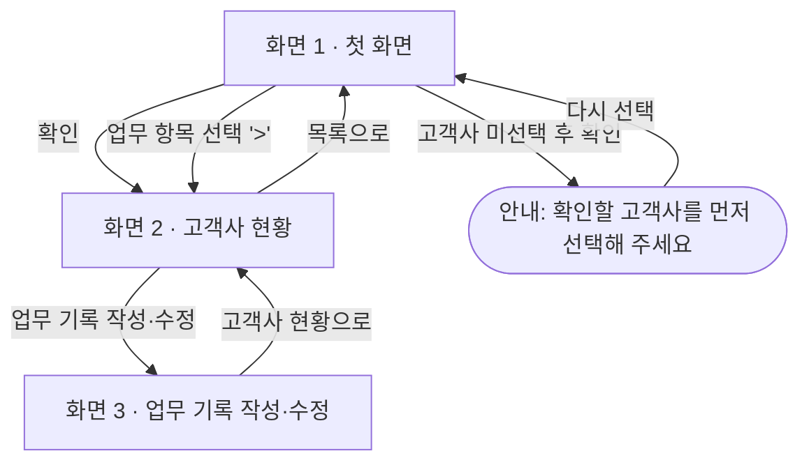

# PRD — 화면 1 · 첫 화면

- 상태 : 완성
- 한 줄 정의 : 여러 고객사를 혼자 관리하는 컨설턴트 미카엘이 고객사를 선택하면 최근 작업·진행상태·다음 할 일·마감일·파일 위치·수정내용을 한 화면에서 확인하여, 업체별 폴더를 일일이 뒤지지 않고 업무를 바로 이어가는 개인용 관리판입니다.

## 1. 문제

### 배경

- 미카엘은 10년 이상 경력의 중소기업 컨설턴트로, 여러 고객사를 혼자 관리하며 정책자금·기업인증·특허·연구소·ESG·수출·인사노무 등 서로 다른 업무를 동시에 진행한다.
- 고객사마다 진행하는 업무가 달라 최근 작업과 다음 할 일을 기억하기 어렵고, 파일 위치와 수정 기록이 흩어져 있다.
- 지금은 요즘 하는 일을 크게 구분하고, 업체별 폴더를 열어 파일을 일일이 찾아본다.

### 목표

- 여러 고객사의 최근 작업과 다음 할 일을 한 화면에서 확인하고, 업체별 폴더를 일일이 뒤지지 않고 업무를 바로 이어갈 수 있게 한다.
- 이전 작업과 파일을 다시 찾는 불편을 줄이고, 기록을 한곳에 모아 다음 업무를 바로 이어갈 수 있게 한다.

## 2. 사용자

### 페르소나

- 10년 이상 경력의 중소기업 컨설턴트 미카엘. 여러 고객사를 혼자 관리하며 정책자금·기업인증·특허·연구소·ESG·수출·인사노무 등 서로 다른 업무를 동시에 진행한다.
- 아침 업무 확인, 고객사 통화·미팅 전, 서류 작성·수정 후 기록, 며칠 뒤 업무 재개, 진행상황 파악이 필요할 때 사용한다.
- 지금은 하는 일을 크게 구분하고, 업체별 폴더를 열어 파일을 일일이 찾아본다.

### 사용자 스토리

- 미카엘로서, 새 고객사를 추가하고 고객사를 선택하면 최근 작업·진행상태·다음 할 일·마감일·파일 위치·수정내용을 한 화면에서 확인하고 싶다. 고객사마다 업무가 달라 최근 작업과 다음 할 일을 기억하기 어렵고 파일 위치와 수정 기록이 흩어져 있기 때문이다.
- 미카엘로서, 업무 기록을 입력·수정하고 저장해 관리판을 다시 열어도 확인하고 싶다. 이전 작업과 파일을 다시 찾는 불편 없이 다음 업무를 바로 이어가고 싶기 때문이다.
- 미카엘로서, 첫 화면에서 마감일이 가까운 업무와 직접 중요 표시한 업무를 먼저 확인하고 싶다. 여러 고객사의 업무를 동시에 진행해 진행상황을 빠르게 파악해야 하기 때문이다.

## 3. 범위

### 넣을 기능

1. 고객사를 추가하거나 선택하면 최근 작업·진행상태·다음 할 일·마감일·파일 위치·주요 수정내용을 한 화면에서 확인한다. (핵심)
2. 업무 기록을 입력·수정하고 저장하여, 관리판을 다시 열어도 확인할 수 있다.
3. 첫 화면에서 마감일이 가까운 업무와 직접 중요 표시한 업무를 먼저 확인한다.
4. 화면 2에서 고객사별로 한 줄 메모를 남기면, 날짜와 함께 아래 목록으로 쌓여 관리판을 다시 열어도 보인다.

### 기능 요구사항

1. 화면 1에서 고객사 이름을 입력하고 추가를 누르면 → 고객사 선택 목록에 그 고객사가 나타나고, 관리판을 다시 열어도 남아 있다. 화면 1에서 고객사를 선택하고 확인을 누르면 → 그 고객사의 최근 작업·진행상태·다음 할 일·마감일·파일 위치·주요 수정내용이 화면 2에 한 번에 나온다. 고객사를 선택하지 않고 확인을 누르면 → "확인할 고객사를 먼저 선택해 주세요" 안내가 나온다.
2. 화면 3의 기존 기록 목록에서 항목을 고르면 → 입력 칸에 그 값이 채워지고, 작업내용·진행상태·다음 할 일·마감일·파일 위치·수정내용을 입력하거나 고친 뒤 저장을 누르면 → 관리판을 다시 열어 같은 고객사를 선택해도 그 기록이 남아 있다.
3. 화면 1을 열면 → 마감일이 가까운 업무 목록과 직접 중요 표시한 업무 목록이 위쪽에 먼저 나온다. 화면 3에서 중요 표시를 체크하고 저장을 누른 뒤, 고객사 현황으로를 눌러 화면 2로 가고 목록으로를 눌러 화면 1로 돌아가면 → 화면 1 상단의 중요 표시한 업무 목록에 그 업무가 보인다.

### 비목표

- 여러 직원이 함께 사용하는 기능 — 미카엘 혼자 쓰는 개인용 관리판이라 여러 사용자를 위한 협업 기능은 필요 없다.
- 고객사가 직접 접속하는 기능 — 개인용 도구이므로 외부인이 접속하는 기능은 범위 밖이다.
- 회원가입과 로그인 — 사용자가 한 명뿐이라 계정 관리 기능이 필요 없다.
- 카카오톡 자동 연결 — 외부 서비스 연동은 이번 과정에서 다루는 범위를 넘어선다.
- 이메일 자동 연결 — 외부 서비스 연동은 이번 과정에서 다루는 범위를 넘어선다.
- 문자와 알림 자동 발송 — 자동 발송 기능은 이번 과정에서 다루는 범위를 넘어선다.
- 실제 파일 업로드와 보관 — 관리판은 파일 위치만 기록하면 되고, 파일 저장소 구축은 별도 과제다.
- 회계 및 세금계산서 관리 — 업무 기록을 확인하는 것이 목적이지 회계 업무 자체를 대신하지 않는다.
- 계약서 자동 작성 — 문서 자동 작성은 업무 기록을 확인한다는 목적과 다른 기능이다.
- 정책자금 신청서 자동 작성 — 문서 자동 작성은 업무 기록을 확인한다는 목적과 다른 기능이다.
- 복잡한 통계와 그래프 — 최근 작업과 다음 할 일 확인이 목적이라 통계 분석까지는 필요 없다.
- 스마트폰 전용 앱 — 이번 과정은 개인용 관리판 화면 구현에 집중하므로 별도 앱 개발은 범위 밖이다.
- AI 자동분석 기능 — 기록을 확인하고 남기는 것이 목적이라 자동분석까지는 필요 없다.

## 4. 화면

### 사용자 흐름

- 화면 1 · 첫 화면 : 마감일이 가까운 업무와 직접 중요 표시한 업무를 먼저 보여주고, 고객사 이름을 입력해 추가하거나 확인할 고객사를 선택하는 화면이다.
- 화면 2 · 고객사 현황 : 선택한 고객사의 진행상태·마감일 요약과 최근 작업·다음 할 일·파일 위치·수정내용을 모아 보여주는 화면이다.
- 화면 3 · 업무 기록 작성·수정 : 기존 기록 목록(작업내용·진행상태·마감일·다음 할 일·파일 위치·수정내용을 담은 항목)에서 고르거나 새로 입력·수정하고, 중요 표시와 저장을 하는 화면이다.

## 5. 완성 기준

### 수용 기준

1. 관리판을 열면 → 화면 1에 마감일이 가까운 업무와 직접 중요 표시한 업무 목록이 보인다.
2. 확인할 고객사를 선택하고 확인을 누르면 최근 작업·진행상태·다음 할 일·마감일·파일 위치·주요 수정내용이 한 화면에 나온다.
3. 고객사를 선택하지 않고 확인을 누르면 "확인할 고객사를 먼저 선택해 주세요" 안내가 나온다.
4. 오늘 처리한 작업내용, 진행상태, 다음 할 일, 마감일, 주요 수정내용을 입력하고 저장을 누르면 → 화면 3에 그대로 머물고, 기존 기록 목록에 방금 저장한 기록이 항목으로 나타난다.
5. 관리판을 다시 열어 같은 고객사를 선택하면 방금 저장한 기록이 최근 작업으로 나온다.
6. 화면 3에서 중요 표시를 체크하고 저장을 누른 뒤, 고객사 현황으로를 눌러 화면 2로 가고 목록으로를 눌러 화면 1로 돌아가면 → 화면 1 상단의 중요 표시한 업무 목록에 해당 업무가 보인다.
7. 화면 1에서 고객사 이름을 입력해 추가를 누르면 → 선택 목록에 그 고객사가 보이고, 관리판을 다시 열어도 남아 있다.
